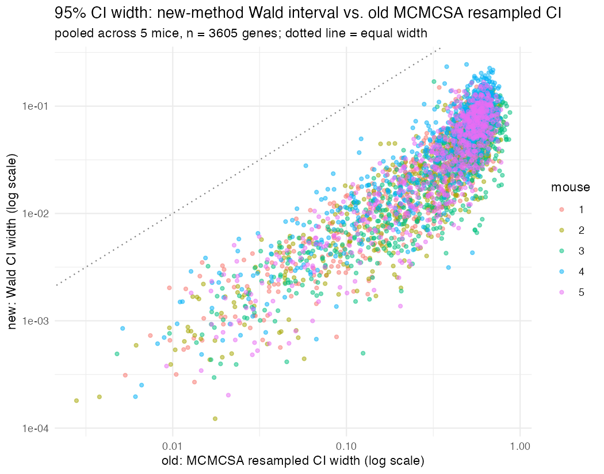
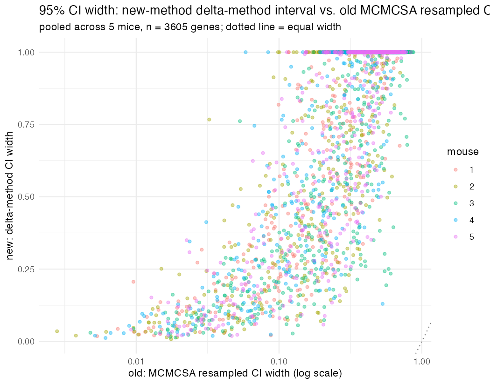

# Old (MCMCSA/DG) vs. new (analytic/L-BFGS) PPV estimates

Comparison of per-gene PPV (positive predictive value) estimates between:

- **Old pipeline**: the original R-based implementation, using a hand-written MCMCSA
  (Markov chain Monte Carlo simulated annealing) search fit to a dichotomized-Gaussian (DG)
  generative model -- no analytic model at all. Source: `.../paper_calling_rate_sim/MERFISH_calling_rate_sim/main.R`
  (`run_MCMCSA()`), results in `merfish_molecular_brakes/FPQC_summaries/`.
- **New pipeline**: the current `flipFISH` package, using the analytic conditional-Bernoulli
  model fit with L-BFGS (`misread.qc()`).

Same codebook (28 bits, 721 genes + 98 blanks), same five mice, same gene panel.

## Data and mouse mapping

The old pipeline's summary statistics were restricted to cells in the **primary auditory
cortex (ACx) only** (`ROIname = "Primary auditory area"` in `make_csv.R`), not whole-brain --
this is why raw count totals differ by ~30-50x from the flipFISH package's own bundled
`summary_stats_all_mice.csv` (which is whole-brain). The comparison here re-fits the **same
ACx-restricted summary stats the old pipeline actually used** (`input_data/`), not the
package's bundled whole-brain data, so both methods are run on identical input cell
populations.

The old results use original animal IDs (`m1, m2, m3, m4, m8`); the flipFISH package
renumbers these sequentially (`1-5`). Mapping (confirmed by the package author, who did the
original renumbering): `m1->1, m2->2, m3->3, m4->4, m8->5`.

## Methods compared

- **Old "good" criterion**: a 3000-step MCMCSA walk (1000 burn-in + 1000 flip-rate search +
  1000 resample steps); the last 1000 steps give a posterior-like sample of PPV per gene; a
  gene is "good" if the **2.5% quantile** of that sample exceeds 0.8.
- **New "good" criterion** (as specified for this comparison): the **point estimate** PPV from
  `misread.qc()` is at least 0.8. `misread.qc()` settings: `max_flips = 6`, `maxeval = 500`,
  `n_restarts = 1`, `blank_weight = 10`, `prior_weight = 0.5`, `dispersion_weight = 0.5`,
  `use_mcmcsa = FALSE` (L-BFGS).

These are not the same kind of threshold -- the old one is a conservative, uncertainty-aware
lower confidence bound; the new one is a plain point estimate -- which matters for
interpreting the "good gene" list comparison below.

## Results

### Correlation

Pooled across all 5 mice (3605 gene-mouse pairs): **Pearson r = 0.843, Spearman r = 0.876**.
Per-mouse Pearson r ranges 0.82-0.90, consistently strong, no outlier mice.

### "Good gene" list comparison

| new_mouse | old label | n genes | old good | new good | both good | old-only | new-only | Jaccard | Pearson r | Spearman r |
|---|---|---|---|---|---|---|---|---|---|---|
| 1 | m1 | 721 | 153 | 305 | 153 | 0 | 152 | 0.502 | 0.837 | 0.869 |
| 2 | m2 | 721 | 146 | 304 | 143 | 3 | 161 | 0.466 | 0.830 | 0.866 |
| 3 | m3 | 721 | 174 | 367 | 174 | 0 | 193 | 0.474 | 0.901 | 0.925 |
| 4 | m4 | 721 | 130 | 285 | 129 | 1 | 156 | 0.451 | 0.819 | 0.848 |
| 5 | m8 | 721 | 121 | 318 | 121 | 0 | 197 | 0.381 | 0.834 | 0.868 |
| **pooled** | - | 3605 | 724 | 1579 | 720 | 4 | 859 | 0.455 | 0.843 | 0.876 |

(Full per-gene data: `gene_level_comparison.csv`. Machine-readable summary: `summary_by_mouse.csv`.)

### Interpreting the gap between the two "good" lists

Two findings, and they say different things:

1. **The old good list nests almost perfectly inside the new one.** 720 of 724 old-good genes
   (99.4%) are also new-good; only 4 exceptions across all 3605 pairs, and in each the new PPV
   (0.70-0.75) isn't far off 0.8 while the old lower bound only barely cleared it (0.81-0.87).
   Where the old method was confident, the new method essentially always agrees.

2. **The new list is more than double the size** (1579 vs. 724), which drives the moderate
   Jaccard (0.46). Of the 859 "new-only" genes, **74% (637) also have an old median PPV >=
   0.8** -- the old method's own central estimate agreed, it just didn't clear the stricter
   2.5%-quantile confidence bound. That's a criterion-stringency artifact, not a real model
   disagreement. The remaining **26% (222) are genuine disagreements** where even the old
   central estimate was below 0.8 -- roughly 6% of all 3605 gene-mouse pairs.

**Bottom line**: two methods built on completely different generative models (analytic
conditional-Bernoulli vs. dichotomized Gaussian) and completely different optimizers (L-BFGS
vs. MCMCSA) agree strongly on the continuous PPV estimate and nearly perfectly on which genes
are confidently good. Most of the apparent gap in the "good" list is the point-estimate-vs.-
confidence-bound criterion difference, not the models disagreeing about the genes.

## What PPV cutoff (new method) best matches the old good-gene list?

The 0.8 point-estimate cutoff used above isn't the fairest comparison, since the old
criterion is a conservative 2.5%-quantile lower bound, not a point estimate -- matching it
with a plain point estimate should need a stricter threshold. Swept the new method's cutoff
from 0.5 to 0.999 (step 0.001) against the fixed old good-gene list and scored by Jaccard
similarity (also checked F1 and raw accuracy; F1 agrees with Jaccard, accuracy peaks slightly
higher but that metric is dominated by the large true-negative count and is less informative
here).

**Best agreement at cutoff ~= 0.938** (Jaccard = 0.635, F1 = 0.777), versus Jaccard = 0.455 at
the naive 0.8 cutoff -- a clean, single-peaked improvement (see `cutoff_optimization.png`),
not a fit to noise. It holds up mouse by mouse, not just pooled:

| mouse | Jaccard @ 0.8 | Jaccard @ 0.938 |
|---|---|---|
| 1 | 0.502 | 0.661 |
| 2 | 0.466 | 0.656 |
| 3 | 0.474 | 0.664 |
| 4 | 0.451 | 0.580 |
| 5 | 0.381 | 0.602 |

Full sweep: `cutoff_sweep.csv`. This makes sense given the criterion mismatch noted above: a
~0.94 point estimate is roughly where its implicit stringency matches the old method's 97.5%-
confidence lower bound on this data.

## New Wald intervals vs. old MCMCSA resampled CIs

For the new analysis, the natural 95% Wald interval for a PPV (a proportion: hit count /
corrected count) is `PPV +/- 1.96 * sqrt(PPV*(1-PPV)/n)`, with `n` = the **observed** corrected
count for that barcode. Compared against the old method's 2.5%/97.5% MCMCSA-resample CI,
per mouse (`wald_vs_mcmcsa.csv`):

| mouse | median Wald width | median MCMCSA width | median ratio (Wald/MCMCSA) |
|---|---|---|---|
| 1 | 0.038 | 0.441 | 0.09 |
| 2 | 0.037 | 0.470 | 0.09 |
| 3 | 0.032 | 0.451 | 0.08 |
| 4 | 0.060 | 0.501 | 0.13 |
| 5 | 0.042 | 0.463 | 0.10 |
| **pooled** | 0.041 | 0.465 | 0.10 |

**The Wald interval is roughly 10x narrower than the MCMCSA interval, for every single gene in
the dataset** (`wald_width < old_width` is true 100% of the time, no exceptions). Consequence:
the old method's median PPV falls inside the new Wald CI only **15.6%** of the time, while the
new point estimate falls inside the old (much wider) MCMCSA CI **94.8%** of the time.

This isn't a bug in the Wald formula -- it's doing exactly what a single-proportion CI does:
quantify sampling noise in the hit/corrected-count ratio *as if* the underlying flip-rate and
bit-flip-correlation parameters were known exactly. The SVD analysis earlier in this
investigation (see `vignettes/benchmarking_notes.Rmd`) found that most of the correlation
parameter space is only weakly identified by this data. A Wald interval has no way to see that
-- it only ever reports noise in the final count ratio, not uncertainty in the parameters that
count ratio was computed from. The MCMCSA resample, whatever its other issues (DG-model
mismatch, a 1000-step walk that may not mix well), does at least carry parameter-level
uncertainty through to the PPV estimate by construction (each walk step uses a different
sampled flip-rate/correlation draw), which is almost certainly why its intervals come out an
order of magnitude wider. **Point estimates from the new method agree well with the old
method's (see above); its Wald interval should not be trusted as an uncertainty estimate.**



## Delta-method CI, added to the package

`mQC()`/`misread.qc()` now return two extra `erctc_plus` columns, `PPV_lower`/`PPV_upper`
(95% CI), computed via a delta-method (Laplace) approximation instead of a naive Wald interval:

`Var(PPV_b) ~= grad(PPV_b)^T * Sigma_theta * grad(PPV_b)`, where `Sigma_theta` is an approximate
parameter covariance from the MSLE term's Gauss-Newton information matrix `M = sum_b weight_b *
d_b^T d_b` (`d_b = d(log(ecc_b+1))/d(theta)`), truncated (eigenvalues > 1e-3 x largest kept) to
handle the same near-singular correlation block the SVD analysis found earlier. `grad(PPV_b)`
uses the quotient rule on `PPV_b = ehc_b/ecc_b`, which needed a new analytic hit-count Jacobian
(`TR()`'s `grad3` / `expected_bc_count()`'s `grad_ehc_b` / `expected_bc_counts()`'s `grad_ehc` --
mirrors the existing `erc`-gradient pattern). `M` deliberately excludes the Gaussian-prior/
dispersion-penalty curvature -- the prior stabilizes optimization, it doesn't represent genuine
data information, and including it would make the CI look tighter exactly where the *data* can't
see (see `mQC_ehc_jacobian_at()`/`mQC_counts_at()`, the new diagnostic exports this also added).
The hit-count gradient was verified against central finite differences (~1e-8 to 1e-11 relative
error across a spread of parameters and blocks) before any of this was used.

**Important, validated finding**: this gives a median CI width of 1.0 (i.e. the full [0,1] range)
for the lower ~50-60% of genes by count, strongly anti-correlated with count (Spearman
`cor(log(count), width) = -0.82`; mean width drops from ~1.0 in the lowest count decile to ~0.12
in the highest). This is not a bug -- a high-count gene (e.g. `Sparcl1`, ecc ~134k) gets a tight,
sensible interval (width ~0.045) dominated by well-identified directions, while most lower-count
genes' PPV gradients have real (if small) components along the correlation block's near-
unidentified directions, and honestly propagating that uncertainty (rather than truncating it
away or ignoring it like Wald does) means their true uncertainty is enormous. Three different
truncation conventions were tried (global 1e-3, standard numerical-rank `n*eps*lambda_max`,
block-separated 1e-3) and all gave substantially-to-mostly maximal widths for the bottom half of
genes -- this is a robust property of the model's identifiability, not a threshold-tuning
artifact.

## Delta-method CI vs. old MCMCSA CI

| mouse | median delta width | median MCMCSA width | ratio |
|---|---|---|---|
| 1 | 1.000 | 0.441 | 2.01 |
| 2 | 1.000 | 0.470 | 1.88 |
| 3 | 1.000 | 0.451 | 1.81 |
| 4 | 1.000 | 0.501 | 1.86 |
| 5 | 1.000 | 0.463 | 1.92 |
| **pooled** | 1.000 | 0.465 | 1.89 |

The delta-method interval is wider than the MCMCSA interval 97% of the time (median ratio ~1.9x)
-- it's more conservative than the resampled CI, not less, which is the opposite problem from
Wald (Wald was ~10x *narrower* than MCMCSA; see above). The old method's median PPV falls inside
the new delta CI 100% of the time (unsurprising given how wide it typically is); the new point
estimate falls inside the old MCMCSA CI 94.8% of the time (same figure as for Wald, since that
number depends only on the point estimate, not which CI method is being compared).



Full data: `delta_vs_mcmcsa.csv`.

## Files in this folder

- `old_vs_new_ppv_scatter.png` -- scatter of new (L-BFGS point estimate) vs. old (MCMCSA
  posterior median) PPV, pooled across all 5 mice, both methods' 0.8 cutoffs marked.
- `cutoff_sweep.csv` / `cutoff_optimization.png` -- Jaccard/F1/accuracy vs. new-method PPV
  cutoff, pooled across all 5 mice (see section above).
- `wald_vs_mcmcsa.csv` / `wald_vs_mcmcsa_width.png` -- per-gene Wald CI (new) vs. MCMCSA
  resampled CI (old) widths, pooled across all 5 mice (see section above).
- `delta_vs_mcmcsa.csv` / `delta_vs_mcmcsa_width.png` -- per-gene delta-method CI (new) vs.
  MCMCSA resampled CI (old) widths, pooled across all 5 mice (see section above). Note these
  `qc_outputs/*.rds` files predate the delta-method CI columns (computed before that change);
  this comparison recomputes the CI from the same fitted parameters via `mQC_ecc_jacobian_at()`/
  `mQC_ehc_jacobian_at()`, not by refitting.
- `summary_by_mouse.csv` -- the table above, machine-readable.
- `gene_level_comparison.csv` -- full per-gene, per-mouse comparison (3605 rows): gene, mouse,
  new PPV, old median/lower/upper, and both methods' good/bad calls.
- `qc_outputs/qc_real_mouse{1-5}.rds` -- the raw `misread.qc()` return object for each mouse
  (real ACx-restricted data, not simulated), as produced by this analysis.
- `input_data/` -- the ACx-restricted summary stats and codebook actually used (copied locally
  so this is reproducible without depending on the network volume or old-repo paths), to
  re-run as:

  ```r
  library(flipFISH)
  codebook <- read.csv("input_data/codebook_obs.csv", row.names = 1)
  g <- read.csv("input_data/summary_stats/summary_stats_m1_genes.csv")
  b <- read.csv("input_data/summary_stats/summary_stats_m1_blanks.csv")
  rownames(g) <- rownames(codebook)[1:721]
  rownames(b) <- rownames(codebook)[722:819]
  STdata <- rbind(g, b)
  qc <- misread.qc(STdata, codebook, n_forks = 8, max_flips = 6, maxeval = 500,
                    blank_weight = 10, prior_weight = 0.5, dispersion_weight = 0.5)
  ```
